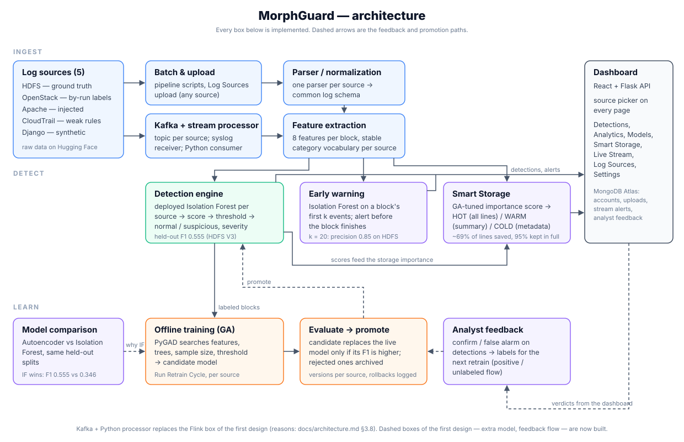

# MorphGuard — Large-Scale Log Analytics for Cloud Security




## Overview
MorphGuard is an evolutionary real-time log analytics system for detecting anomalies in cloud environments using streaming technologies and machine learning. The name reflects the two halves of the system: behaviour that *morphs* — models continuously re-optimised by a genetic algorithm — in service of *guarding* the cloud estate.

## Objective
To design a SIEM-inspired system capable of:
- Real-time log ingestion
- Behavioral anomaly detection
- Evolutionary optimization using Genetic Algorithms
- Security alert generation

## Proposed Architecture
Application → Streaming Engine → Feature Processing → ML Model → Alert System

## Folder Responsibilities
- `parser/` reads raw logs, extracts structured fields, classifies event types, and returns structured data.
- `feature_engineering/` generates numerical features from structured logs.
- `detection/` trains and runs anomaly detection models such as Isolation Forest and Autoencoders.
- `optimization/` implements Genetic Algorithm workflows for feature selection, threshold tuning, and hyperparameter optimization.
- `dashboard/` visualizes logs, anomalies, model performance, and alerts.

## Dataset
The raw HDFS log (`HDFS.log`, ~1.5GB) and its anomaly labels (`anomaly_label.csv`) aren't committed to
this repo — they're hosted on Hugging Face:
https://huggingface.co/datasets/Ashwin-deals/large-scale-log-analytics-hdfs-data

Download them into `data/raw/hdfs/` before running the pipeline:

```bash
python3 scripts/download_dataset.py
```

The other sources (OpenStack, Apache with its injected copy, CloudTrail, synthetic Django) are in
the same Hugging Face dataset, one folder each; `--source all` (or one source name) fetches them
into `data/raw/<source>/`.

Everything else under `data/` (processed logs, features, predictions, model metrics) is either
regenerated by the scripts below or produced by the training/optimization pipeline — none of it is
committed either; see `.gitignore`.

## HDFS Feature Pipeline
Build the Sprint 2 datasets from the raw HDFS log:

```bash
python3 scripts/build_hdfs_features.py
```

This writes:
- `data/processed/hdfs_structured.csv`
- `data/processed/hdfs_cleaned.csv`
- `data/features/features.csv`

For a quick smoke test, limit the number of parsed raw log lines:

```bash
python3 scripts/build_hdfs_features.py --limit 1000
```

## Smart Storage
Decides how much of each block's log to keep, using its anomaly score, event count, block size and
error flag:
- **HOT:** keep every line.
- **WARM:** keep a short summary.
- **COLD:** drop the block and keep one metadata line.

A genetic algorithm tunes the weights and thresholds. Evaluation is on held-out blocks, scored by a
model refitted on the tuning half only.

```bash
python3 scripts/optimize_storage_policy.py   # writes data/storage/policy_best.json + storage_report.json
```

Held-out result (`data/storage/storage_report.json`, 287,531 blocks, scored by V3):
- **Storage:** 68.71% of log lines saved (1,747,980 of 5,587,093 kept).
- **Retention:** 0.953 of anomalies kept in full; weighted retention 0.955, which meets the 0.95 target on unseen blocks.
- **WARM tier:** a small middle tier: 9.5% of blocks, keeping about 2 of a block's 23.5 lines. Almost all retention comes from HOT.
- **Baselines:** it beats keep-all, keep-flagged-only, tuned top-k% and random sampling at the same saving.

API: `GET /api/storage/summary`, `GET /api/storage/policy`, `POST /api/storage/simulate`.

## Early Warning
Scores a block from only its first k events (k = 3, 5, 10, 20), with one Isolation Forest per k and a
GA-tuned alert threshold. Results are on a held-out 30% test split.

```bash
python3 scripts/build_early_warning.py      # writes data/models/early_warning/ + data/evaluation/early_warning_report.json
```

Held-out result (`data/evaluation/early_warning_report.json`, 172,519 test blocks):
- **Best trade-off:** k = 20, with precision 0.8490, recall 0.5722 and F1 0.6836.
- **On blocks still running when the alert fires:** F1 0.5996, with the alert arriving with 33.9% of the block still to come on average.
- **Smaller k:** most correct alerts are short blocks that had already ended, so they are not early warnings.

API: `GET /api/early-warning/summary`.

## Real-Time Streaming (Kafka)
A single-broker Kafka (KRaft) replays log lines through `logs.raw`. A stream processor keeps
per-block state, raises early-warning alerts at k events, and assigns a Smart Storage tier when a block
finishes. It publishes to `alerts` and `storage.decisions` and saves alerts to MongoDB
(`stream_alerts`).

```bash
docker compose up -d
python3 -m streaming.processor --from-beginning --idle-flush 8 --stop-after-idle 20
python3 -m streaming.producer --limit 50000 --rate 5000      # in a second terminal
```

API: `GET /api/stream/status`, `GET /api/stream/alerts`. Full walkthrough: `docs/streaming_guide.md`.

## OpenStack Source
OpenStack nova logs from LogHub are a second labeled source. Each instance-id session is a block, labeled
by the file it came from (198 of 2,069 sessions come from the abnormal run). The source has its own
models and metrics under `data/models/openstack/` and `data/evaluation/openstack_*`; the HDFS models are
untouched.

```bash
python3 scripts/run_source_pipeline.py --source openstack
```

Held-out result (`data/evaluation/openstack_report.json`, 621 test sessions with 59 anomalies):

| Model | Precision | Recall | F1 |
|---|---|---|---|
| Baseline Isolation Forest | 0.0759 | 0.2034 | 0.1106 |
| GA-optimised (OpenStack V2) | 0.1043 | 0.2034 | 0.1379 |

**Caveat:** the labels mark which run a session came from, not which session had a fault. Only 4 instances
are faulty per the dataset's own `anomaly_labels.txt`, and the model catches 0 of them. `hour_of_day`
alone separates the runs with AUC 0.849.

Upload an OpenStack log with `source=openstack` on `POST /api/sources/upload`, or use the source
selector on the Log Sources page.

## Technologies
- Python 3.11+ (3.12 in CI), Flask, Gunicorn
- Pandas, NumPy, scikit-learn (Isolation Forest), PyGAD (genetic algorithm)
- MongoDB Atlas (accounts, uploads, stream alerts, analyst feedback), bcrypt, JWT
- Apache Kafka (single KRaft broker via `docker-compose.yml`, `confluent-kafka` client), with a Python stream processor
- Hugging Face Hub (datasets and derived files)
- Docker; nginx on a GCP VM
- Frontend: React 18 + Vite, Recharts (separate repo)

The Django logs are a synthetic data source. Django is not part of the stack.

## Project Status
Review-ready.
- **Sources:** five log sources (HDFS, OpenStack, Apache, CloudTrail, Django).
- **Pipeline:** each has its own parser, models, promote-if-better lineage, Smart Storage policy and early warning.
- **API and dashboard:** every source is served through `?source=` on every endpoint and dashboard page.
- **Streaming:** works for every source.
- **Feedback:** analyst verdicts feed the next retrain.
- **Model choice:** an Autoencoder is benchmarked against Isolation Forest.

`docs/project_report.md` has the results and their limitations.

## Auth API (login/register)
A minimal Flask + MongoDB service backs the frontend login page.

```bash
python -m venv venv && source venv/bin/activate
pip install -r requirements.txt
cp .env.example .env   # set MONGO_URI / JWT_SECRET as needed
python app.py           # runs on http://localhost:5000
```

Requires a running MongoDB instance (local or Atlas) reachable at `MONGO_URI`. Passwords are hashed with bcrypt before storage — plaintext passwords are never persisted.

Endpoints: `docs/api_reference.md` lists every route. Auth uses `POST /api/auth/register`, `POST /api/auth/login`, `POST /api/auth/change-password`, `GET /api/auth/me` and `GET /api/health`.

## Team Members
Akilan J [CB.SC.U4CSE23002]
Ashwin V [CB.SC.U4CSE23009]
E Raksha Raj [CB.SC.U4CSE23021]
Mithresh M [CB.SC.U4CSE23039]
